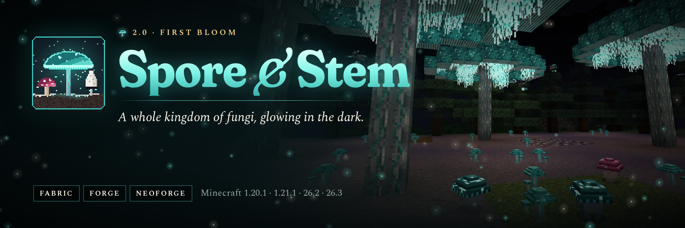

# Spore & Stem



**A whole kingdom of fungi for Minecraft.** Giant glowing mushrooms and three fungal woods, nine new mushrooms
modelled in real 3D, cultivation logs and mushroom cooking, Mycoleather armor, the Mycosis infection, seven fungal
creatures and the Myceliarch, a towering fungal boss. Clean, readable fungus: eerie and beautiful, never gross.
Mod id: `spore_and_stem`.

Spore & Stem 2.0 is a ground-up rewrite of the project formerly published as *Genetically Modified Monsters* (1.x):
new code, new content and a fully generated asset set. It runs on **Minecraft 26.3, 26.2 and 1.21.1** (Fabric,
NeoForge) and **Minecraft 1.20.1** (Fabric, Forge) with the same content.

## Features

- **Three giant fungi** that grow from bone meal and fill the world: the bioluminescent **Glowcap**, the springy
  **Bouncecap** and the dripping **Inkcap**, each with its own full building set (stems, hyphae, stripped variants,
  planks, stairs, slabs, fences, gates, doors, trapdoors, buttons and pressure plates).
- **Nine small mushrooms** in real 3D (Glowcap, Bouncecap, Inkcap, Morel, Chanterelle, Deathcap, Frostcap,
  Emberstool, Puffball), all pottable, most edible, each with its own effect.
- **Fungal blocks:** shelf fungus you can climb, mycelial veils with glowing bulbs, giant puffballs, glowcap gills
  and lanterns, truffle soil, Mycelial Soil that grows mushrooms in any light, and **Cultivation Logs** that fruit
  the mushroom you inoculate them with.
- **Mushroom cooking:** roasted morels, chanterelle toast, glowcap soup, bouncecap jelly, frostcap tea, ember
  skewers, truffle stew, forager's stew and an antifungal tonic.
- **Mycosis:** a slow fungal infection. The infected dead rise as Shamblers. Spore Ward, Mycoleather and tonics
  keep you safe.
- **Creatures:** tameable Sporelings, truffle-hunting Trufflers, Glowmoths, and the Bloatshroom, Shambler, Sporemaw
  and Mimicap, each with its own animated model.
- **The Myceliarch:** a two-phase boss summoned with a Fruiting Heart. It drops the Spore Heart for the
  **Bloomreaver** and the **Crown of the Bloom**.
- No new biomes and no dependencies beyond Fabric API: everything grows into the vanilla world through biome tags
  that datapacks can change.

See [docs/USAGE.md](docs/USAGE.md) for every recipe, number and mechanic, and [docs/DESIGN.md](docs/DESIGN.md) for
the design spec.

## Which jar do I download?

Jar names are `spore_and_stem-{loader}-{minecraft}-{modVersion}.jar`. Match **both** the Minecraft version and the
loader.

| Minecraft | Java | Fabric jar (needs Fabric API) | NeoForge / Forge jar |
| --- | --- | --- | --- |
| 1.20.1 | 17+ | `…-fabric-1.20.1-….jar` | `…-forge-1.20.1-….jar` (Forge 47) |
| 1.21.1 | 21+ | `…-fabric-1.21.1-….jar` | `…-neoforge-1.21.1-….jar` (NeoForge 21.1.80+) |
| 26.2 | 25+ | `…-fabric-26.2-….jar` | `…-neoforge-26.2-….jar` |
| 26.3 | 25+ | `…-fabric-26.3-….jar` | `…-neoforge-26.3-….jar` |

Install on both the server and every client.

## Building

Each Minecraft version is a separate MultiLoader Gradle workspace with its own wrapper. These are the only supported
targets (the NightBeam convention): 8 jars per release, all with the same version.

| Minecraft | Loaders | Java | Folder |
| --- | --- | --- | --- |
| 1.20.1 | Forge, Fabric | 17 | `1.20.1/{common,forge,fabric}` |
| 1.21.1 | NeoForge, Fabric | 21 | `1.21.1/{common,neoforge,fabric}` (the reference) |
| 26.2 | NeoForge, Fabric | 25 | `26.2/{common,neoforge,fabric}` |
| 26.3 | NeoForge, Fabric | 25 | `26.3/{common,neoforge,fabric}` |

```bash
./gradlew buildAll             # every workspace, then the 8 loader jars into releases/
cd 1.20.1 && ./gradlew build   # Java 17 toolchain
cd 1.21.1 && ./gradlew build   # Java 21
cd 26.3 && ./gradlew build     # Java 25 (the same for 26.2)
```

The root build hands the 26.x workspaces `JAVA_HOME_25_X64` (or `-Pjava25Home=<jdk>`) and the others
`JAVA_HOME_21_X64` (or `-Pjava21Home=<jdk>`); without them each workspace uses the current `JAVA_HOME`.
Jars land in `<workspace>/<loader>/build/libs/spore_and_stem-<loader>-<minecraft>-<version>.jar`. Every
workspace's `gradle.properties` carries the same `version=` as `VERSION` (`./gradlew checkVersions`; set it with
`./gradlew syncVersion -PmodVersion=x.y.z`). `python3 scripts/check_targets.py workspaces` checks the targets, the
shared version and the metadata ranges. Release notes for a version live in `patchnotes/<version>.md`.

## Releasing

CI (`.github/workflows/ci.yml`) builds all 8 jars on every push to `main` that touches the build. Publishing to
CurseForge is `.github/workflows/publish.yml`, run by hand (`version`, `dry_run`) or by a `v*.*.*` tag;
it never runs on a plain push. It refuses a second release of the mod on the same day (Africa/Tunis), takes the jars
from `releases/`, the GitHub Release or a build from source, and fails unless exactly the 8 jars are found. It needs
the secrets `CURSEFORGE_TOKEN` (upload token) and `CURSEFORGE_API_KEY` (Core API key); the variable `CURSEFORGE_ID`
is optional (the project id `1390363` is the fallback). Try it first with `dry_run=true`. NightBeam publishes to
CurseForge only; the Modrinth page stays up but gets no new versions.

## Assets

Every texture, 3D model, creature model and animation, sound, language file, recipe, loot table, tag, worldgen file
and advancement is generated by code in `tools/assets/` (Python 3 with Pillow and NumPy; ffmpeg for audio):

```bash
python3 tools/assets/build.py               # regenerate everything (1.21.1, then the 1.20.1, 26.2, 26.3 ports)
python3 tools/assets/build.py --no-sounds   # keep the synthesised audio as it is
python3 tools/assets/check.py               # validate against the registries of the last dev run
python3 tools/assets/check.py --workspace 1.20.1
python3 tools/assets/preview.py textures block            # contact sheets and 3D renders for review
python3 tools/assets/creature_preview.py sporeling --gif  # a creature's rig, texture and animations
```

Creature models are written once in Python (`tools/assets/ss/entities/`); their Java geometry and keyframe
animations under `client/entity/geo` and `client/entity/anim` are generated from it. The 1.20.1, 26.2 and 26.3
resources are derived from the 1.21.1 output by converters (`tools/assets/ss/ports/`). Art follows
[tools/assets/STYLE.md](tools/assets/STYLE.md).

## Testing

```bash
tools/qa/smoke_server.sh fabric            # boots a dedicated server on a fresh world and fails on any
tools/qa/smoke_server.sh neoforge          #  recipe, loot, tag, worldgen or mod error
tools/qa/smoke_server.sh fabric 1.20.1
tools/qa/smoke_server.sh forge 1.20.1
```

GameTests (13 per loader): `./gradlew :fabric:runGametest` and `:neoforge:runGameTestServer` in `1.21.1/`,
`:fabric:runGametest` and `:forge:runGameTestServer` in `1.20.1/`.

`tools/qa/` also runs a dev server and client under Xvfb with software rendering, driven over RCON and xdotool
(`devrun.sh`, `client.py`); `marketing/source/capture.py` uses it to take the listing screenshots.

## Project layout

```
1.21.1/                      MultiLoader workspace (common + fabric + neoforge), the reference
1.20.1/                      MultiLoader workspace (common + fabric + forge), ported from 1.21.1
26.2/                        MultiLoader workspace (common + fabric + neoforge), ported from 1.21.1
26.3/                        MultiLoader workspace (common + fabric + neoforge), ported from 26.2
  common/src/main            hand-written code and resources
  common/src/generated       generated assets and data (never edit by hand)
docs/                        DESIGN.md (spec) and USAGE.md (player guide)
tools/assets/                asset pipeline, style guide, validator, previews
tools/qa/                    dev runs, smoke tests, RCON and client drivers
marketing/                   CurseForge description, artwork and screenshots
patchnotes/                  release notes per version
scripts/                     target/jar checks and the same-day release guard used by CI and Publish
releases/                    optional prebuilt release jars the Publish workflow uploads
```

## Contributing, security, license

- [CONTRIBUTING.md](CONTRIBUTING.md) and [CODE_OF_CONDUCT.md](CODE_OF_CONDUCT.md)
- [.github/SECURITY.md](.github/SECURITY.md)
- Licensed under the [Apache License 2.0](LICENSE); see [NOTICE](NOTICE). All textures, models, animations and
  sounds are original works generated by the code in `tools/assets`.
