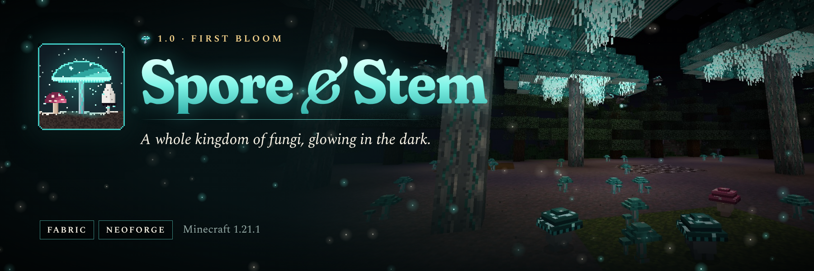

# Spore & Stem



**A whole kingdom of fungi for Minecraft.** Giant glowing mushrooms and three fungal woods, nine new mushrooms
modelled in real 3D, cultivation logs and mushroom cooking, Mycoleather armor, the Mycosis infection, seven fungal
creatures and the Myceliarch, a towering fungal boss. Clean, readable fungus: eerie and beautiful, never gross.
Mod id: `spore_and_stem`.

Spore & Stem 1.0 is a ground-up rewrite of the project formerly published as *Genetically Modified Monsters*: new
code, new content and a fully generated asset set. It runs on **Fabric** and **NeoForge** for **Minecraft 1.21.1**;
more versions will follow from the same codebase.

## Features

- **Three giant fungi** that grow from bone meal and fill the world: the bioluminescent **Glowcap**, the springy
  **Bouncecap** and the dripping **Inkcap**, each with its own full building set (stems, hyphae, stripped variants,
  planks, stairs, slabs, fences, gates, doors, trapdoors, buttons and pressure plates).
- **Nine small mushrooms** in real 3D (Glowcap, Bouncecap, Inkcap, Morel, Chanterelle, Deathcap, Frostcap,
  Emberstool, Puffball), all pottable, most edible, each with its own effect.
- **Fungal blocks:** shelf fungus you can climb, mycelial veils with glowing bulbs, giant puffballs, glowcap gills
  and lanterns, truffle soil, Mycelial Soil that grows mushrooms in any light, and **Cultivation Logs** that fruit
  the mushroom you inoculate them with.
- **Mushroom cooking:** roasted morels, chanterelle toast, glowcap soup, bouncecap jelly, frostcap tea, ember
  skewers, truffle stew, forager's stew and an antifungal tonic.
- **Mycosis:** a slow fungal infection. The infected dead rise as Shamblers. Spore Ward, Mycoleather and tonics
  keep you safe.
- **Creatures:** tameable Sporelings, truffle-hunting Trufflers, Glowmoths, and the Bloatshroom, Shambler, Sporemaw
  and Mimicap, each with its own animated model.
- **The Myceliarch:** a two-phase boss summoned with a Fruiting Heart. It drops the Spore Heart for the
  **Bloomreaver** and the **Crown of the Bloom**.
- No new biomes and no dependencies beyond Fabric API: everything grows into the vanilla world through biome tags
  that datapacks can change.

See [docs/USAGE.md](docs/USAGE.md) for every recipe, number and mechanic, and [docs/DESIGN.md](docs/DESIGN.md) for
the design spec.

## Supported versions

| Workspace | Minecraft | Loaders | Java |
| --- | --- | --- | --- |
| `1.21.1/` | 1.21.1 | Fabric (Loader ≥ 0.16, Fabric API), NeoForge ≥ 21.1.80 | 21 |

Install on both the server and every client.

## Building

```bash
cd 1.21.1
./gradlew build                 # jars in fabric/build/libs and neoforge/build/libs
```

From the repository root, `./gradlew buildAll` builds every workspace and collects the jars in `all-jars/`.

## Assets

Every texture, 3D model, creature model and animation, sound, language file, recipe, loot table, tag, worldgen file
and advancement is generated by code in `tools/assets/` (Python 3 with Pillow and NumPy; ffmpeg for audio):

```bash
python3 tools/assets/build.py               # regenerate everything into 1.21.1/common/src/generated/resources
python3 tools/assets/build.py --no-sounds   # keep the synthesised audio as it is
python3 tools/assets/check.py               # validate against the registries of the last dev run
python3 tools/assets/preview.py textures block            # contact sheets and 3D renders for review
python3 tools/assets/creature_preview.py sporeling --gif  # a creature's rig, texture and animations
```

Creature models are written once in Python (`tools/assets/ss/entities/`); their Java geometry and keyframe
animations under `client/entity/geo` and `client/entity/anim` are generated from it. Art follows
[tools/assets/STYLE.md](tools/assets/STYLE.md).

## Testing

```bash
tools/qa/smoke_server.sh fabric      # boots a dedicated server on a fresh world and fails on any
tools/qa/smoke_server.sh neoforge    #  recipe, loot, tag, worldgen or mod error
```

`tools/qa/` also runs a dev server and client under Xvfb with software rendering, driven over RCON and xdotool
(`devrun.sh`, `client.py`); `marketing/source/capture.py` uses it to take the listing screenshots.

## Project layout

```
1.21.1/                      MultiLoader workspace (common + fabric + neoforge)
  common/src/main            hand-written code and resources
  common/src/generated       generated assets and data (never edit by hand)
docs/                        DESIGN.md (spec) and USAGE.md (player guide)
tools/assets/                asset pipeline, style guide, validator, previews
tools/qa/                    dev runs, smoke tests, RCON and client drivers
marketing/                   CurseForge/Modrinth description, artwork and screenshots
patchnotes/                  release notes per version
```

## Contributing, security, license

- [CONTRIBUTING.md](CONTRIBUTING.md) and [CODE_OF_CONDUCT.md](CODE_OF_CONDUCT.md)
- [.github/SECURITY.md](.github/SECURITY.md)
- Licensed under the [Apache License 2.0](LICENSE); see [NOTICE](NOTICE). All textures, models, animations and
  sounds are original works generated by the code in `tools/assets`.
